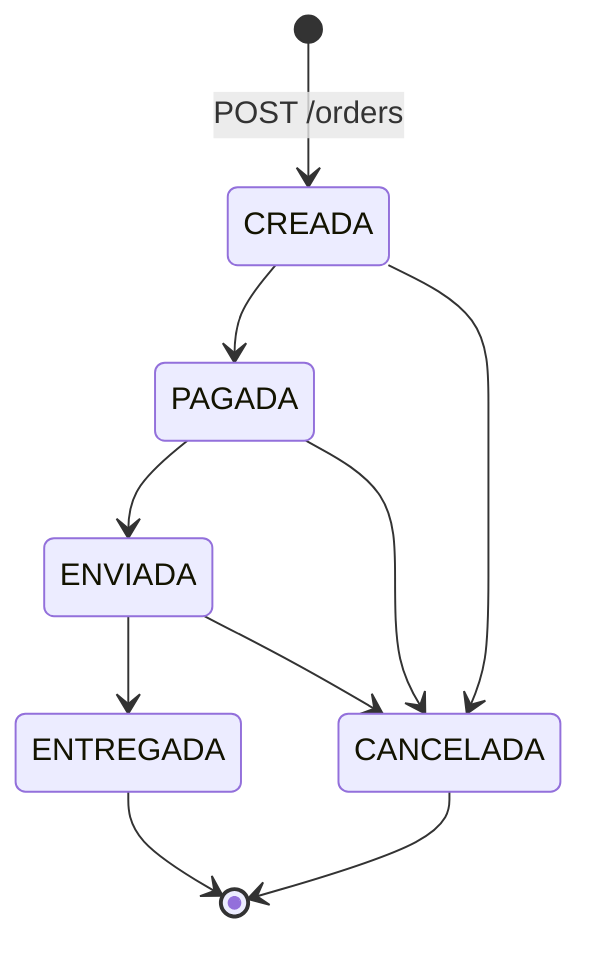
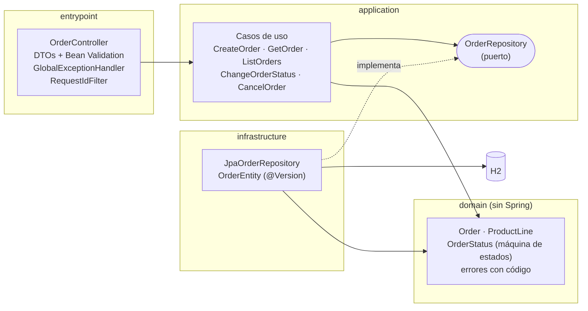
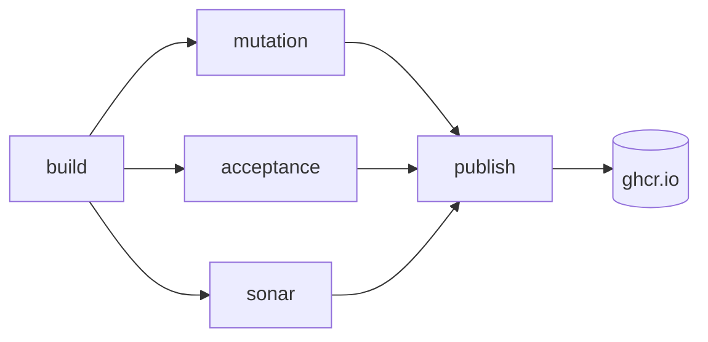

# RTBC Orders API

[](https://github.com/NataliaGarciaB/rtbc-orders-api/actions/workflows/ci.yml)
[](https://sonarcloud.io/project/overview?id=NataliaGarciaB_rtbc-orders-api)
[](https://sonarcloud.io/project/overview?id=NataliaGarciaB_rtbc-orders-api)
[](https://sonarcloud.io/project/overview?id=NataliaGarciaB_rtbc-orders-api)
[](LICENSE)

API REST para gestionar órdenes de compra: creación, consulta y ciclo de vida de la orden, con reglas de negocio protegidas por una estrategia de pruebas basada en riesgo y quality gates automatizados.

| | |
|---|---|
| **Stack** | Java 17 · Spring Boot 4.1 · Spring Data JPA · H2 · Maven Wrapper |
| **Pruebas** | JUnit 6 · Mockito · AssertJ · ArchUnit · JaCoCo · PIT · Karate |
| **Entrega** | Docker · GitHub Actions · SonarCloud · GitHub Container Registry |
| **Calidad actual** | 148 pruebas JUnit · 30 escenarios de aceptación · cobertura 100 % de líneas y ramas · mutation score 100 % |

## Contenido
- [Qué hace](#qué-hace)
- [Inicio rápido](#inicio-rápido)
- [Arquitectura](#arquitectura)
- [Decisiones técnicas](#decisiones-técnicas)
- [Estrategia de calidad](#estrategia-de-calidad)
- [Cómo ejecutar las pruebas](#cómo-ejecutar-las-pruebas)
- [Evidencias](#evidencias)
- [Observabilidad](#observabilidad)
- [Versionamiento](#versionamiento)
- [Uso de IA](#uso-de-ia)
- [Estructura del repositorio](#estructura-del-repositorio)

---

## Qué hace

Una orden tiene un cliente, una o más líneas de producto, un total y un estado:

```json
{
  "id": "0339e188-bd81-4dd9-a1c1-e223da0184b9",
  "cliente": "Juan Pérez",
  "productos": [ { "id": "P001", "cantidad": 2, "valorUnitario": 100000 } ],
  "total": 200000,
  "estado": "CREADA"
}
```

| Método | Ruta | Descripción | Respuestas |
|---|---|---|---|
| `POST` | `/orders` | Crea una orden en estado `CREADA` | 201 · 400 |
| `GET` | `/orders` | Lista las órdenes | 200 |
| `GET` | `/orders/{id}` | Consulta una orden | 200 · 400 · 404 |
| `PATCH` | `/orders/{id}/status` | Cambia el estado: `{ "estado": "PAGADA" }` | 200 · 400 · 404 · 409 |
| `DELETE` | `/orders/{id}` | Cancela la orden (cancelación lógica) | 200 · 404 · 409 |

El contrato completo está en [`docs/api/openapi.yaml`](docs/api/openapi.yaml) y se publica en Swagger UI.

### Reglas de negocio

| Regla | Descripción |
|---|---|
| RN-01 | Una orden debe contener al menos un producto |
| RN-02 | La cantidad de cada producto debe ser mayor que cero |
| RN-03 | El total se calcula en el servidor; si el cliente envía un total, se ignora |
| RN-04 | Una orden entregada no puede ser cancelada |
| RN-05 | Una orden no puede ser enviada si no ha sido pagada |
| RN-06 | No se permiten transiciones de estado inválidas |



La matriz completa de las 25 transiciones, con el código HTTP de cada una, está en [`docs/maquina-estados.md`](docs/maquina-estados.md).

### Errores

Todas las respuestas de error usan `application/problem+json` (RFC 9457) con un `codigo` estable, para que los clientes no dependan del texto del mensaje:

| Código HTTP | `codigo` | Cuándo |
|---|---|---|
| 400 | `VALIDACION` | Datos inválidos; `errores` indica cada campo (por ejemplo `productos[0].cantidad`) |
| 400 | `ORDEN_NO_PAGADA` | Enviar una orden que no ha sido pagada (RN-05) |
| 404 | `ORDEN_NO_ENCONTRADA` | La orden no existe |
| 409 | `TRANSICION_INVALIDA` | Transición no permitida desde el estado actual (RN-04, RN-06) o modificación concurrente |
| 500 | `ERROR_INTERNO` | Error inesperado, sin detalles internos en la respuesta |

---

## Inicio rápido

### Con Docker (solo requiere Docker)

```bash
docker build -t challenge-api .
docker run -p 8080:8080 challenge-api
```

O con Docker Compose, que espera a que la API esté lista:

```bash
docker compose up --build -d --wait
```

### Local (requiere Java 17)

```bash
./mvnw spring-boot:run          # Windows: .\mvnw spring-boot:run
```

### Probarla

- **Swagger UI:** http://localhost:8080/swagger-ui.html
- **Salud:** http://localhost:8080/actuator/health

```bash
curl -i -X POST http://localhost:8080/orders \
  -H "Content-Type: application/json" \
  -d '{"cliente":"Juan Pérez","productos":[{"id":"P001","cantidad":2,"valorUnitario":100000}]}'
```

La base de datos es H2 en memoria: cada arranque empieza vacío.

---

## Arquitectura

Arquitectura hexagonal en cuatro capas. Las dependencias apuntan siempre hacia el dominio, y una prueba de ArchUnit rompe el build si alguna regla se viola.



| Capa | Responsabilidad | Regla |
|---|---|---|
| `domain` | Entidades, máquina de estados y reglas RN-01 a RN-06 | No depende de ninguna otra capa ni de frameworks |
| `application` | Un caso de uso por acción y el puerto de persistencia | Depende solo de `domain` |
| `infrastructure` | Adaptador JPA/H2 que implementa el puerto | Nadie depende de ella |
| `entrypoint` | Controlador REST, DTOs, manejo de errores y filtro de correlación | Nadie depende de ella |

El dominio se prueba con JUnit puro, sin levantar Spring, en milisegundos. Cambiar H2 por otra base de datos solo afectaría a `infrastructure`.

---

## Decisiones técnicas

Cada decisión está registrada con su contexto y consecuencias en [`docs/decisiones.md`](docs/decisiones.md) (22 ADR). Las más relevantes:

| Decisión | Por qué |
|---|---|
| Máquina de estados centralizada en `OrderStatus` | Un único lugar define las transiciones; la matriz completa se prueba con una sola prueba parametrizada |
| 400 para enviar sin pagar, 409 para el resto de transiciones inválidas | 400 indica una precondición incumplida; 409, un conflicto con el estado actual del recurso |
| `DELETE` como cancelación lógica que responde 200 con la orden | Se conserva el historial y el resultado se verifica sin una segunda llamada |
| Total calculado en el dominio con `BigDecimal` | El cliente no puede manipularlo y no hay errores de redondeo |
| Validación en el dominio y en los DTOs | El dominio nunca queda inválido; los DTOs reportan todos los errores de una vez |
| Bloqueo optimista con `@Version` | Dos cambios simultáneos sobre la misma orden no pueden saltarse la máquina de estados |
| Contrato de diseño como única fuente de verdad | Swagger UI publica `openapi.yaml` tal cual; no hay una segunda especificación generada que pueda contradecirlo |
| Lectura y escritura estricta de JSON | Una cantidad `1.5` se rechaza en lugar de truncarse a `1`; los decimales nunca salen en notación científica |
| Spring Boot 4.1 | La línea 3.x terminó su soporte gratuito el 2026-06-30 |
| Karate contra el contenedor en CI | Las pruebas de aceptación validan el mismo artefacto que se entrega |
| Actions fijadas por SHA de commit | Una etiqueta como `@v7` se puede mover; fijar el SHA protege el pipeline de la cadena de suministro |

---

## Estrategia de calidad

La estrategia completa está en [`docs/qa/estrategia-pruebas.md`](docs/qa/estrategia-pruebas.md) y la relación de cada regla con su riesgo y sus pruebas en [`docs/qa/trazabilidad.md`](docs/qa/trazabilidad.md).

### Basada en riesgo

El esfuerzo de prueba se concentra donde un fallo hace más daño:

| Riesgo | Nivel | Cómo se mitiga |
|---|---|---|
| R01: se permite una transición inválida | **Alto** | Matriz de 25 transiciones en el dominio, casos de uso, API y muestra en Karate |
| R02: total mal calculado o manipulado | **Alto** | Decimales, valores grandes y total enviado por el cliente, de punta a punta hasta la base de datos |
| R03: se crea una orden inválida | **Alto** | Valores límite en dominio, DTO y Karate |
| R09: pruebas que pasan sin detectar regresiones | **Alto** | Mutation testing con PIT (mutadores STRONGER) |
| R04-R06: errores inconsistentes, entradas inesperadas, fuga de información | Medio | Pruebas de integración web y del manejador de errores |
| R07: el contenedor se comporta distinto que en local | Medio | Karate contra el contenedor en cada ejecución del pipeline |
| R08: cambios concurrentes | Bajo | Prueba con dos transacciones reales |

### Pirámide de pruebas

Cada comportamiento se prueba en el nivel más bajo posible; los niveles superiores confirman la integración.

| Nivel | Herramienta | Cantidad |
|---|---|---|
| Aceptación sobre el contenedor | Karate | 30 escenarios |
| Integración web y de aplicación | `@WebMvcTest`, `@SpringBootTest` | 55 pruebas |
| Integración de persistencia | `@DataJpaTest` (H2) | 6 pruebas |
| Arquitectura | ArchUnit | 2 reglas |
| Unitarias de casos de uso | JUnit + Mockito | 16 pruebas |
| Unitarias de dominio | JUnit | 69 pruebas |

Técnicas de diseño: transición de estados (matriz completa), valores límite, particiones de equivalencia y tablas de decisión.

### Quality gates

Cada gate es un job del pipeline y un check obligatorio para hacer merge a `main`:

| Gate | Umbral | Job |
|---|---|---|
| Pruebas | 0 fallidas, también ejecutadas en orden inverso | `build` |
| Cobertura de líneas y de ramas | ≥ 80 % | `build` (JaCoCo) |
| Mutation score | ≥ 70 % | `mutation` (PIT) |
| Aceptación | 30/30 escenarios contra el contenedor | `acceptance` (Karate) |
| Análisis estático | Quality gate de SonarCloud en verde | `sonar` |



`publish` solo corre en `main` y en tags `v*`, y publica en GHCR la misma imagen que validó Karate.

---

## Cómo ejecutar las pruebas

| Qué | Comando |
|---|---|
| Unitarias, integración y cobertura (con umbral) | `./mvnw verify` |
| Una sola regla de negocio | `./mvnw test -Dgroups=RN-05` |
| Mutation testing (con umbral) | `./mvnw test-compile org.pitest:pitest-maven:mutationCoverage` |
| Aceptación: levanta la app, ejecuta Karate y la apaga | `./mvnw verify -Pacceptance` |
| Aceptación de una sola regla | `./mvnw verify -Pacceptance -Dkarate.tags=@RN-05` |
| Aceptación contra el contenedor, sin Java | `docker compose --profile acceptance run --rm karate` |
| Verificación completa de la imagen Docker (Windows) | `powershell -ExecutionPolicy Bypass -File .\scripts\verificar-docker.ps1` |

Reportes generados:

| Reporte | Ubicación |
|---|---|
| Cobertura (JaCoCo) | `target/site/jacoco/index.html` |
| Mutación (PIT) | `target/pit-reports/index.html` |
| Aceptación (Karate) | `target/karate-reports/karate-summary.html` |

---

## Evidencias

Todas las cifras corresponden a la [ejecución del pipeline en `main`](https://github.com/NataliaGarciaB/rtbc-orders-api/actions/runs/39342687865). Cada ejecución publica los reportes completos como artifacts y un resumen de métricas.

| Evidencia | Resultado | Reporte |
|---|---|---|
| Cobertura (JaCoCo) | **100 % de líneas (249/249) y de ramas (57/57)** | Artifact `cobertura-jacoco` · local: `target/site/jacoco/index.html` |
| Mutation testing (PIT, mutadores STRONGER) | **66 de 66 mutantes eliminados (100 %)** | Artifact `mutacion-pit` · local: `target/pit-reports/index.html` |
| Aceptación (Karate contra el contenedor) | **30 de 30 escenarios** en 6 features | Artifact `aceptacion-karate` · local: `target/karate-reports/karate-summary.html` |
| Análisis estático (SonarCloud) | **Quality gate en verde**, calificación A en seguridad, confiabilidad y mantenibilidad | [Proyecto en SonarCloud](https://sonarcloud.io/project/overview?id=NataliaGarciaB_rtbc-orders-api) |
| Imagen Docker | Construcción, ejecución, contenedor `healthy`, usuario sin privilegios, logs JSON y Karate: 9 de 9 verificaciones | [docs/docker.md](docs/docker.md#evidencia-de-ejecución) |

La cobertura solo excluye la clase de arranque de Spring Boot, que no tiene lógica ([ADR-013](docs/decisiones.md#adr-013-exclusiones-de-cobertura-y-mutación)). Para comprobar que las pruebas de aceptación detectan errores, se introdujeron temporalmente defectos en las reglas que cubren los escenarios críticos, y todos fueron detectados ([detalle](docs/qa/estrategia-pruebas.md#9-pruebas-de-aceptación-con-karate)).

### El pipeline bloquea cambios que no cumplen los quality gates

El [PR #9](https://github.com/NataliaGarciaB/rtbc-orders-api/pull/9) introdujo a propósito tres problemas, uno por ejecución, y se cerró sin merge:

| Etapa | Cambio | Resultado | Ejecución |
|---|---|---|---|
| 1 | Se rompe RN-05 | ❌ `build`: 4 pruebas fallan | [ver](https://github.com/NataliaGarciaB/rtbc-orders-api/actions/runs/39338585896) |
| 2 | Código nuevo sin pruebas | ❌ `build`: las pruebas pasan, pero la cobertura de ramas baja a 72 % | [ver](https://github.com/NataliaGarciaB/rtbc-orders-api/actions/runs/39339430837) |
| 3 | Una prueba que ejecuta el código sin verificar nada | ✅ `build` (100 % de líneas) y ✅ `sonar` · ❌ `mutation`: 66 % | [ver](https://github.com/NataliaGarciaB/rtbc-orders-api/actions/runs/39340382138) |

La etapa 3 muestra por qué el mutation testing es un gate: la cobertura y el análisis estático dieron el cambio por bueno porque el código se ejecuta, pero solo PIT detectó que la prueba no verifica ningún resultado.

En el primer análisis, SonarCloud detectó que las actions del pipeline estaban referenciadas por etiqueta (`@v7`) y no por SHA, un riesgo de cadena de suministro. Se corrigió fijando todas por SHA de commit.

---

## Observabilidad

| Qué | Cómo |
|---|---|
| Eventos de negocio | Logs de `Orden creada`, `Estado cambiado` y `Transición rechazada` (con su `codigo`), en formato `clave=valor` y sin datos personales |
| Correlación | Cada request lleva un `X-Request-Id` que aparece en todas sus líneas de log y en la respuesta. Un valor enviado por el cliente solo se reutiliza si es seguro, para evitar inyección en los logs |
| Logs en el contenedor | JSON (Elastic Common Schema) con `requestId` como campo propio |
| Errores inesperados | La excepción completa queda en el log; la respuesta al cliente es genérica |
| Salud | `/actuator/health`, el único endpoint de actuator expuesto, sin detalles internos |
| Pipeline | Resumen de cobertura, mutación y aceptación en cada ejecución; reportes como artifacts |

---

## Versionamiento

- **Conventional Commits** en español: `tipo(ámbito): descripción` ([guía](CONTRIBUTING.md)).
- **Una rama por fase**, integrada mediante PR con **merge commit**, para conservar la secuencia TDD en el historial: cada regla de negocio tiene un commit `test(...)` en rojo seguido de un commit `feat(...)` en verde.
- **`main` protegida:** sin push directo ni force push; merge solo con los checks `build`, `mutation`, `acceptance` y `sonar` en verde.
- **Tags semánticos por fase** (`v0.1.0` a `v1.0.0`), que además publican la imagen versionada en GHCR.

---

## Uso de IA

Usé **Claude Code** (Anthropic) como potenciador de mi trabajo de ingeniería: me permitió acelerar la implementación y dedicar más tiempo a lo que define la calidad de una solución, que es el diseño, el análisis de riesgo y la verificación, sin delegar el criterio.

| Lo que aporté | Cómo me apoyó la IA |
|---|---|
| La estrategia de pruebas basada en riesgo, el alcance de cada fase y las decisiones técnicas | Proponer alternativas con sus ventajas y desventajas para decidir con más información |
| El diseño de la arquitectura, del contrato de la API y de la máquina de estados | Implementar con TDD a partir de ese diseño y documentar cada decisión |
| La revisión de cada cambio antes de integrarlo, la prueba exploratoria y la validación de la imagen en Docker | Automatizar verificaciones repetitivas, como probar cada commit por separado o inyectar defectos para comprobar que las pruebas los detectan |
| El criterio para aceptar, ajustar o descartar cada propuesta | Investigar compatibilidad de versiones, configuraciones y comportamientos de las herramientas |

Prácticas para un uso responsable:

- **Nada se integró sin revisión.** Cada fase se revisó localmente antes de publicarse, y ningún cambio llega a `main` sin pasar los quality gates.
- **Verificación antes que confianza.** TDD con commits en rojo y en verde visibles en el historial, mutation testing y defectos inyectados a propósito para comprobar que las pruebas los detectan.
- **Las propuestas también se pusieron a prueba.** Así aparecieron hallazgos como una dependencia entre pruebas que solo se manifestaba en el CI (Linux), Jackson 3 truncando cantidades decimales sin avisar y actions del pipeline sin fijar por SHA. Todos se corrigieron con su prueba o su control correspondiente.
- **Sin datos sensibles.** Los tokens existen solo como secretos de GitHub y los logs no registran datos personales.

---

## Estructura del repositorio

```
├── src/main/java/com/rtbc/orders
│   ├── domain/            Entidades, máquina de estados, reglas de negocio
│   ├── application/       Casos de uso y puerto de persistencia
│   ├── infrastructure/    Adaptador JPA/H2
│   └── entrypoint/        API REST, errores, correlación
├── src/test/java          Pruebas unitarias, de integración y de arquitectura
├── src/test/resources/acceptance   Escenarios Karate
├── docs/
│   ├── api/openapi.yaml   Contrato de la API
│   ├── decisiones.md      Registro de decisiones (ADR)
│   ├── maquina-estados.md Transiciones y códigos HTTP
│   ├── docker.md          Ejecución con Docker y evidencia
│   └── qa/                Estrategia de pruebas y trazabilidad
├── scripts/verificar-docker.ps1
├── Dockerfile · docker-compose.yml · .dockerignore
└── .github/workflows/ci.yml
```

## Licencia

[MIT](LICENSE)
