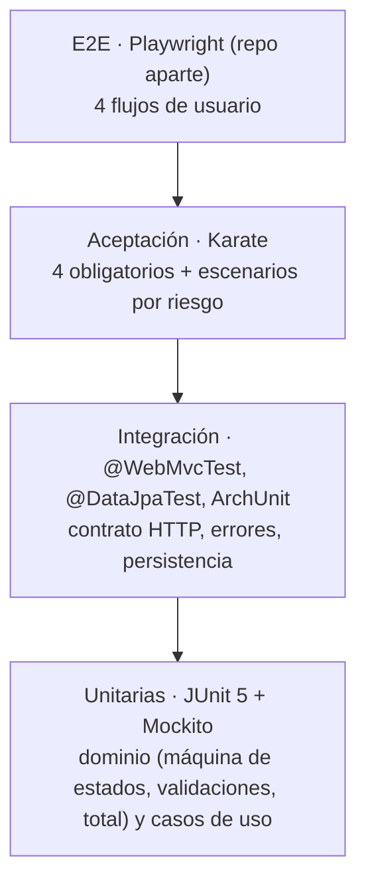

# Estrategia de pruebas basada en riesgo

## 1. Objetivo
Dar confianza, con evidencia, de que la API cumple las reglas RN-01 a RN-06 y el contrato [openapi.yaml](../api/openapi.yaml). El esfuerzo de prueba se concentra donde un fallo hace más daño. Las métricas (cobertura y mutation score) son señales de que las pruebas son buenas, no el objetivo.

## 2. Matriz de riesgos

**Escala:** Probabilidad (P) e Impacto (I) de 1 a 3. Nivel = P × I: **Alto ≥ 6**, Medio de 3 a 5, Bajo ≤ 2.

| ID | Riesgo | RN | P | I | Nivel | Mitigación (dónde se prueba) |
|---|---|---|---|---|---|---|
| R01 | Se permite una transición de estado inválida, por ejemplo cancelar una orden entregada o enviar sin pagar | RN-04, RN-05, RN-06 | 3 | 3 | **9 Alto** | Prueba parametrizada de las 25 combinaciones en el dominio, casos de uso con Mockito y `Scenario Outline` en Karate |
| R02 | El total queda mal calculado, pierde precisión o lo manipula el cliente | RN-03 | 2 | 3 | **6 Alto** | Pruebas unitarias con varias líneas, decimales y valores grandes en `BigDecimal`. Karate envía un `total` falso y verifica que se ignora |
| R03 | Se crea una orden inválida: sin productos, cantidad ≤ 0, valor ≤ 0, sin cliente | RN-01, RN-02 | 3 | 2 | **6 Alto** | Valores límite (−1, 0, 1) y particiones de equivalencia en dominio y DTO. Karate cubre los casos negativos principales |
| R04 | Códigos HTTP o formato de error inconsistentes que rompen a los clientes | — | 2 | 2 | 4 Medio | `@WebMvcTest` del manejador global. Karate verifica `status` y `codigo` |
| R05 | Una entrada inesperada provoca un 500: UUID mal formado, JSON roto, estado desconocido | — | 2 | 2 | 4 Medio | `@WebMvcTest` con entradas malformadas. Karate cubre el 404 y el estado desconocido |
| R06 | El error filtra detalles internos: stack trace, SQL, nombres de clases | — | 1 | 3 | 3 Medio | `@WebMvcTest` verifica que el body de error no tenga `trace` ni `exception`. Configuración `server.error.include-*` en `never` |
| R07 | El artefacto Docker se comporta distinto que en local | — | 2 | 2 | 4 Medio | Karate corre en CI contra el contenedor (ADR-012). Healthcheck en docker-compose |
| R08 | Dos actualizaciones simultáneas sobre la misma orden dejan un estado inconsistente | RN-06 | 1 | 2 | 2 Bajo | Bloqueo optimista (ADR-016) con `@Version` en JPA (conflicto → 409). Prueba en `@DataJpaTest` |
| R09 | Las pruebas pasan pero no detectan regresiones (aserciones débiles) | — | 2 | 3 | **6 Alto** | Mutation testing con PIT ≥ 70% en `domain` y `application`. Se analiza cada mutante sobreviviente |
| R10 | La arquitectura se erosiona: el dominio depende de Spring o de JPA | — | 2 | 1 | 2 Bajo | Prueba con ArchUnit en el build |

**Fuera de alcance**, por decisión explícita: autenticación y autorización, pruebas de carga y rendimiento, y persistencia durable (H2 en memoria). Se mencionan en el README como deuda técnica conocida.

## 3. Pirámide de pruebas

| Nivel | Qué valida | Herramienta | Velocidad | Proporción aproximada |
|---|---|---|---|---|
| Unitarias de dominio | RN-01 a RN-06, total, límites | JUnit 5 (sin Spring) | ms | ~60% |
| Unitarias de casos de uso | Orquestación, 404, llamadas al puerto | JUnit 5 + Mockito | ms | ~15% |
| Integración web | Contrato HTTP, validación de DTOs, mapeo de errores 400/404/409, que no se filtre información | `@WebMvcTest` | s | ~15% |
| Integración de persistencia | Mapeo JPA, `BigDecimal`, bloqueo optimista | `@DataJpaTest` (H2) | s | ~5% |
| Arquitectura | Dependencias entre capas | ArchUnit | s | 1-2 pruebas |
| Aceptación | Comportamiento de punta a punta en la API desplegada | Karate | s | ~5% |
| E2E (plus) | Flujos de usuario en la interfaz | Playwright | min | 4 flujos |

**Regla:** cada comportamiento se prueba en el nivel más bajo posible. Los niveles altos solo confirman la integración y no repiten todas las combinaciones. Por ejemplo, las 25 transiciones se prueban completas en el dominio, y Karate cubre una muestra representativa de cada código HTTP.

## 4. Técnicas de diseño de pruebas
| Técnica | Aplicación |
|---|---|
| Pruebas de transición de estados | Matriz 5×5 de [maquina-estados.md](../maquina-estados.md): cobertura de todas las transiciones válidas e inválidas (0-switch), más el flujo completo `CREADA → … → ENTREGADA` |
| Valores límite | `cantidad`: −1, 0, 1. `valorUnitario`: 0, 0.01, 0.001 (3 decimales). Largo de `cliente`: 0, 1, 120, 121. `productos`: 0 y 1 elemento |
| Particiones de equivalencia | Request válido; inválido por campo; JSON mal formado; UUID válido inexistente frente a UUID mal formado |
| Tablas de decisión | Combinaciones de estado actual y acción (PATCH o DELETE) contra el código HTTP esperado |
| Pruebas de error | Campos ausentes, tipos incorrectos, campos extra (`total` y `estado` en POST) |

## 5. Datos de prueba
- **Builders en Java** (`OrderTestBuilder`) para datos de dominio legibles. Cada prueba arranca de una orden válida y cambia solo lo que prueba.
- **Karate:** JSON base en `classpath` más `set` y `remove` por escenario. Cada escenario crea sus propias órdenes (sin dependencia de orden ni de datos compartidos).
- No se usan datos personales reales.

## 6. Quality gates
El build de Maven y el pipeline de CI fallan si se cumple cualquiera de estas condiciones:

| Gate | Umbral | Herramienta |
|---|---|---|
| Pruebas fallidas | 0 | Surefire, Failsafe, Karate |
| Cobertura de líneas | ≥ 80% | JaCoCo `check` |
| Cobertura de ramas | ≥ 80% | JaCoCo `check` |
| Mutation score | ≥ 70% | PIT `mutationThreshold` |
| Reglas de arquitectura | 0 violaciones | ArchUnit |
| (Opcional) Análisis estático | Quality Gate verde | SonarCloud |

Las exclusiones de cobertura y mutación están justificadas en [ADR-013](../decisiones.md#adr-013-exclusiones-de-cobertura-y-mutación).

## 7. Criterios de entrada y salida por fase
- **Entrada:** la fase anterior está cerrada con PR fusionado, el tag publicado y el CI en verde.
- **Salida:** todos los quality gates aplicables pasan, la [matriz de trazabilidad](trazabilidad.md) está actualizada y las evidencias (reportes) están generadas.

## 8. Observabilidad y evidencias
| Evidencia | Origen | Dónde queda |
|---|---|---|
| Reporte de cobertura | JaCoCo HTML | Artifact del pipeline y captura en el README |
| Reporte de mutación | PIT HTML | Artifact del pipeline y captura en el README |
| Reporte de aceptación | Karate HTML | Artifact del pipeline |
| Logs de cambios y rechazos de estado | Logs estructurados de la aplicación (id de la orden, estado origen y destino, resultado) | Consola del contenedor |
| Ejecución del pipeline | GitHub Actions | Enlace y captura en el README |
| Demostración de que el quality gate funciona | PR `demo/quality-gate` que falla a propósito | Captura en el README |
